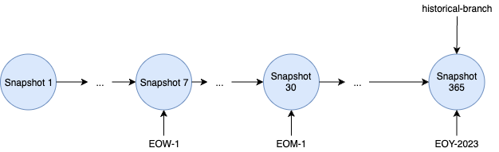
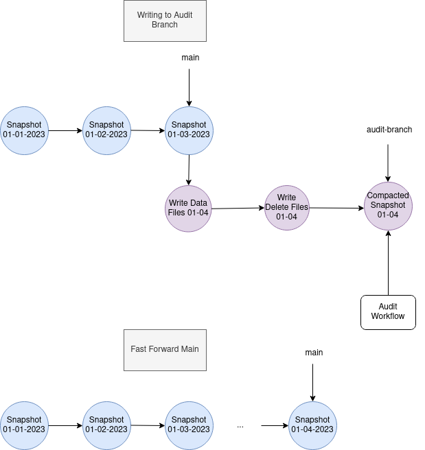

<!-- Apache Iceberg documentation, Apache License 2.0. Russian translation modified from the original. -->

# Ветвление и теги

## Обзор

Метаданные Iceberg-таблицы содержат snapshot log, представляющий последовательность изменений таблицы. Snapshots — фундаментальная часть Iceberg: на них основаны изоляция readers и time-travel запросы. Для контроля размера метаданных и стоимости хранения Iceberg предоставляет механизмы управления жизненным циклом snapshots, например `expire_snapshots`, который удаляет неиспользуемые snapshots и ставшие ненужными data files согласно retention properties таблицы.

**Для более гибкого управления жизненным циклом snapshots Iceberg поддерживает branches и tags — именованные ссылки на snapshots со своими независимыми жизненными циклами. Они управляются retention policies на уровне branch/tag.**

Branch представляет независимую lineage snapshots и указывает на её head. Для branches и tags можно задать maximum reference age, определяющий, когда должна быть удалена сама ссылка на snapshot. У branch также есть retention properties: минимальное количество snapshots, которые необходимо сохранить в branch, и максимальный возраст отдельного snapshot. Эти параметры применяются при запуске `expireSnapshots`.

Детали алгоритма приведены в спецификации Iceberg, раздел `Snapshot Retention Policy`.

## Сценарии использования

Branching и tagging можно использовать для выполнения требований GDPR и сохранения важных исторических snapshots для аудита. Branches также подходят для data-engineering workflows: например, для экспериментальных веток, на которых тестируются и валидируются новые jobs.

### Исторические теги

Tags позволяют удерживать важные исторические snapshots для аудита.



На диаграмме показана политика хранения, задаваемая через Spark SQL.

1. Сохранять один snapshot в неделю в течение месяца. Для этого weekly snapshot помечается tag с retention один месяц.

```sql
-- Create a tag for the first end of week snapshot. Retain the snapshot for a week
ALTER TABLE prod.db.table CREATE TAG `EOW-01` AS OF VERSION 7 RETAIN 7 DAYS;
```

2. Сохранять один snapshot в месяц в течение 6 месяцев:

```sql
-- Create a tag for the first end of month snapshot. Retain the snapshot for 6 months
ALTER TABLE prod.db.table CREATE TAG `EOM-01` AS OF VERSION 30 RETAIN 180 DAYS;
```

3. Сохранять один snapshot в год бессрочно. По умолчанию retention branch/tag не ограничен:

```sql
-- Create a tag for the end of the year and retain it forever.
ALTER TABLE prod.db.table CREATE TAG `EOY-2023` AS OF VERSION 365;
```

4. Создать временный `test-branch`, который хранится 7 дней, сохраняя последние два snapshots:

```sql
-- Create a branch "test-branch" which will be retained for 7 days along with the latest 2 snapshots
ALTER TABLE prod.db.table CREATE BRANCH `test-branch` RETAIN 7 DAYS WITH SNAPSHOT RETENTION 2 SNAPSHOTS;
```

### Audit branch



Диаграмма показывает использование audit branch для валидации write workflow.

1. Убедиться, что включено `write.wap.enabled`:

```sql
ALTER TABLE db.table SET TBLPROPERTIES (
    'write.wap.enabled'='true'
);
```

2. Создать `audit-branch` от snapshot 3; branch используется для записи и хранится одну неделю:

```sql
ALTER TABLE db.table CREATE BRANCH `audit-branch` AS OF VERSION 3 RETAIN 7 DAYS;
```

3. Записи выполняются в отдельный `audit-branch`, независимо от истории основной таблицы:

```sql
-- WAP Branch write
SET spark.wap.branch = audit-branch
INSERT INTO prod.db.table VALUES (3, 'c');
```

4. Validation workflow проверяет состояние `audit-branch`, например качество данных.
5. После успешной проверки `main` можно fast-forward к head `audit-branch`, обновив состояние основной таблицы:

```sql
CALL catalog_name.system.fast_forward('prod.db.table', 'main', 'audit-branch');
```

6. Ссылка на branch будет удалена, когда через неделю будет запущен `expireSnapshots`.

## Использование

Создание, чтение и запись branches/tags поддерживаются Java-библиотекой Iceberg и интеграциями Spark/Flink:

- [[java-api-quickstart#Branching and tagging|Iceberg Java Library]]
- [[spark-ddl|Spark DDL]]
- [[spark-queries|Spark Reads]]
- [[spark-writes|Spark Branch Writes]]
- [[flink-queries|Flink Reads]]
- [[flink-writes|Flink Branch Writes]]

## Выбор схемы при работе с branches и tags

Важно понимать: текущая schema таблицы действует для всех branches. При работе с branch для валидации записи используется **schema таблицы**. При запросе к tag используется **schema snapshot** — schema ID, на который указывал snapshot в момент создания.

Создадим таблицу и добавим данные:

```sql
CREATE TABLE db.table (id bigint, data string, col float);
INSERT INTO db.table VALUES (1, 'a', 1.0), (2, 'b', 2.0), (3, 'c', 3.0);
SELECT * FROM db.table;
1   a   1.0
2   b   2.0
3   c   3.0
```

Создадим `test_branch`, указывающий на текущий snapshot, и прочитаем его:

```sql
ALTER TABLE db.table CREATE BRANCH test_branch;

SELECT * FROM db.table.branch_test_branch;
1   a   1.0
2   b   2.0
3   c   3.0
```

Изменим schema: удалим `col` и добавим `new_col`:

```sql
ALTER TABLE db.table DROP COLUMN col;
ALTER TABLE db.table ADD COLUMN new_col date;
INSERT INTO db.table VALUES (4, 'd', date('2024-04-04')), (5, 'e', date('2024-05-05'));

SELECT * FROM db.table;
1   a   NULL
2   b   NULL
3   c   NULL
4   d   2024-04-04
5   e   2024-05-05
```

Запрос к head branch возвращает данные с использованием **schema таблицы**:

```sql
SELECT * FROM db.table.branch_test_branch;
1   a   NULL
2   b   NULL
3   c   NULL

SELECT * FROM db.table VERSION AS OF 'test_branch';
1   a   NULL
2   b   NULL
3   c   NULL
```

Time-travel запрос по snapshot ID использует **schema snapshot**:

```sql
SELECT * FROM db.table.refs;
test_branch BRANCH  8109744798576441359 NULL    NULL    NULL
main        BRANCH  6910357365743665710 NULL    NULL    NULL

SELECT * FROM db.table VERSION AS OF 8109744798576441359;
1   a   1.0
2   b   2.0
3   c   3.0
```

При записи в branch для валидации используется **schema таблицы**:

```sql
INSERT INTO db.table.branch_test_branch VALUES (6, 'e', date('2024-06-06')), (7, 'g', date('2024-07-07'));

SELECT * FROM db.table.branch_test_branch;
6   e   2024-06-06
7   g   2024-07-07
1   a   NULL
2   b   NULL
3   c   NULL
```
