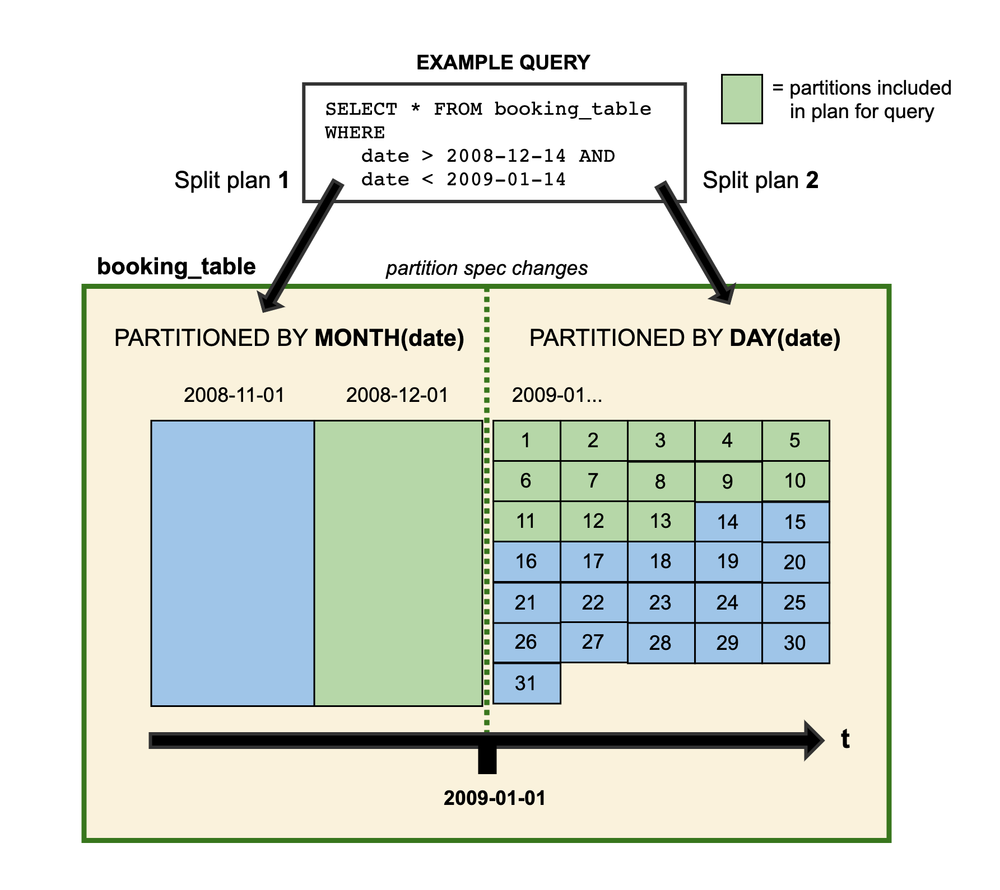

<!--
 - Licensed to the Apache Software Foundation (ASF) under one or more
 - contributor license agreements. See the NOTICE file distributed with
 - this work for additional information regarding copyright ownership.
 - The ASF licenses this file to You under the Apache License, Version 2.0.
 - Russian translation: modified from the original documentation.
 -->

# Эволюция

Iceberg поддерживает **эволюцию таблицы на месте (in-place table evolution)**. Можно [[#Эволюция схемы|изменять схему таблицы]] подобно SQL — в том числе внутри вложенных структур — или [[#Эволюция партиционирования|менять схему партиционирования]] при изменении объёма данных. Iceberg не требует дорогостоящих операций вроде перезаписи данных таблицы или миграции в новую таблицу.

Например, в Hive схему партиционирования таблицы изменить нельзя: переход с дневного партиционирования на почасовое требует создания новой таблицы. Поскольку запросы зависят от партиций, их также приходится переписывать. В некоторых форматах даже такие простые изменения, как переименование колонки, либо не поддерживаются, либо могут создавать [[#Корректность|проблемы корректности данных]].

## Эволюция схемы

Iceberg поддерживает следующие изменения схемы:

- **Add** — добавить новую колонку в таблицу или поле во вложенный `struct`;
- **Drop** — удалить существующую колонку или поле из вложенного `struct`;
- **Rename** — переименовать существующую колонку или поле вложенного `struct`;
- **Update** — расширить тип колонки, поля `struct`, ключа/значения `map` или элемента `list`;
- **Reorder** — изменить порядок колонок или полей во вложенном `struct`.

Обновления схемы Iceberg являются **изменениями метаданных**, поэтому для их выполнения не требуется переписывать data files.

Обратите внимание: для ключей `map` не поддерживается добавление или удаление полей `struct`, если это изменило бы семантику равенства ключей.

### Корректность

Iceberg гарантирует, что **изменения при эволюции схемы независимы и не имеют побочных эффектов**, причём без перезаписи файлов:

1. Добавленная колонка никогда не начинает читать существующие значения другой колонки.
2. Удаление колонки или поля не изменяет значения любых других колонок.
3. Изменение колонки или поля не изменяет значения любых других колонок.
4. Изменение порядка колонок или полей `struct` не меняет значения, связанные с конкретным именем колонки или поля.

Iceberg отслеживает каждую колонку таблицы по уникальному ID. При добавлении колонке назначается новый ID, поэтому существующие данные не могут быть ошибочно интерпретированы как данные новой колонки.

- Форматы, которые отслеживают колонки по имени, могут случайно «восстановить» удалённую колонку при повторном использовании её имени, что нарушает гарантию №1.
- Форматы, которые отслеживают колонки по позиции, не могут удалить колонку без изменения соответствия имён позициям, что нарушает гарантию №2.

## Эволюция партиционирования

Схему партиционирования Iceberg-таблицы можно изменить в существующей таблице, поскольку запросы не обращаются к значениям партиций напрямую.

При изменении partition spec старые данные, записанные по прежней спецификации, остаются без изменений. Новые данные записываются в новом layout согласно новой спецификации. Метаданные каждой версии схемы партиционирования хранятся отдельно. Поэтому при планировании запроса Iceberg отдельно планирует файлы для каждого partition layout и применяет фильтр, выведенный специально для него.



*Данные за 2008 год партиционированы по месяцам. Начиная с 2009 года таблица изменена так, что новые данные партиционируются по дням. Оба варианта партиционирования могут одновременно существовать в одной таблице.*

Iceberg использует [[partitioning|скрытое партиционирование]], поэтому для высокой производительности не требуется писать запросы под конкретный физический layout. Пользователь задаёт условия на логические колонки, а Iceberg автоматически исключает файлы, которые не могут содержать подходящие данные.

Эволюция партиционирования — операция над метаданными; она не инициирует немедленную перезапись существующих файлов.

Java API Iceberg предоставляет `updateSpec` для обновления partition spec. Например, следующий код добавляет поле партиционирования, распределяющее значения `id` по 8 bucket, и удаляет существующее поле `category`:

```java
Table sampleTable = ...;
sampleTable.updateSpec()
    .addField(bucket("id", 8))
    .removeField("category")
    .commit();
```

Spark поддерживает изменение partition spec через SQL `ALTER TABLE`; подробнее см. [[spark-ddl#ALTER TABLE ... ADD PARTITION FIELD|Spark SQL]].

## Эволюция порядка сортировки

Как и partition spec, sort order Iceberg можно изменять в существующей таблице. После изменения порядка сортировки старые данные, записанные согласно предыдущему порядку, остаются без изменений. Движки могут записывать новые данные в соответствии с последним sort order либо без сортировки, если сортировка слишком дорога.

Java API предоставляет `replaceSortOrder`. Например, следующий код создаёт новый sort order, где `id` сортируется по возрастанию с `null` в конце, а `category` — по убыванию с `null` в начале:

```java
Table sampleTable = ...;
sampleTable.replaceSortOrder()
   .asc("id", NullOrder.NULLS_LAST)
   .desc("category", NullOrder.NULLS_FIRST)
   .commit();
```

Spark поддерживает изменение порядка сортировки через `ALTER TABLE`; подробнее см. [[spark-ddl#ALTER TABLE ... WRITE ORDERED BY|Spark SQL]].

## Навигация

- [[../MOC|Карта документации]]
- [[schemas|Схемы]]
- [[partitioning|Партиционирование]]
