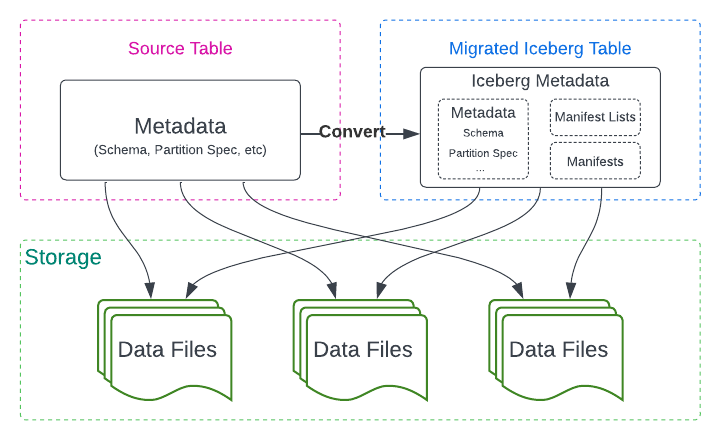
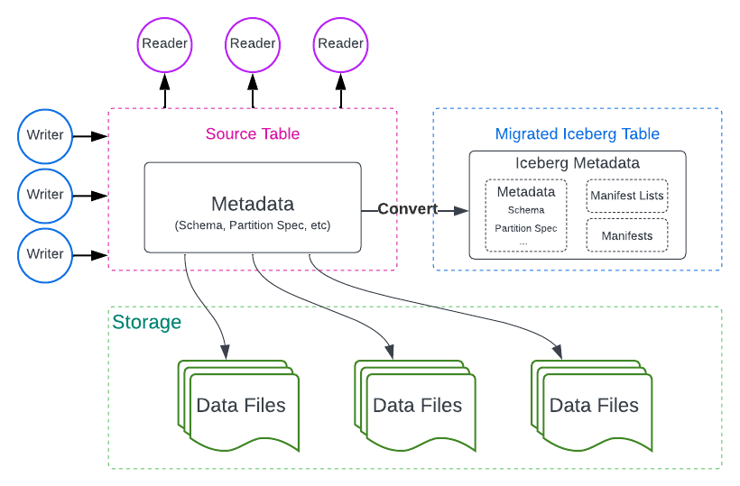
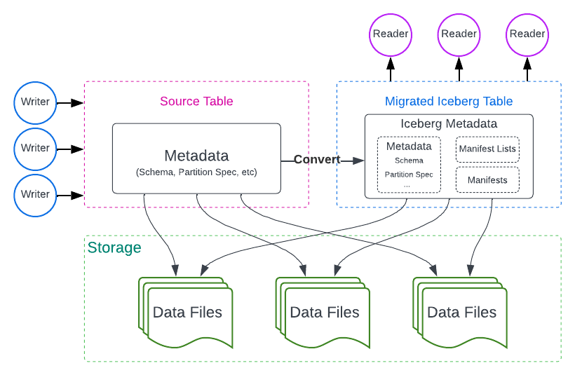
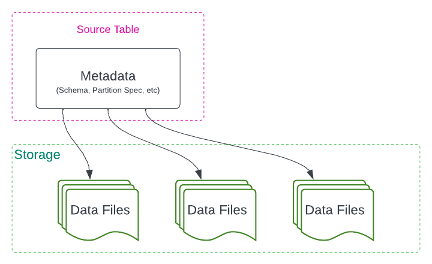
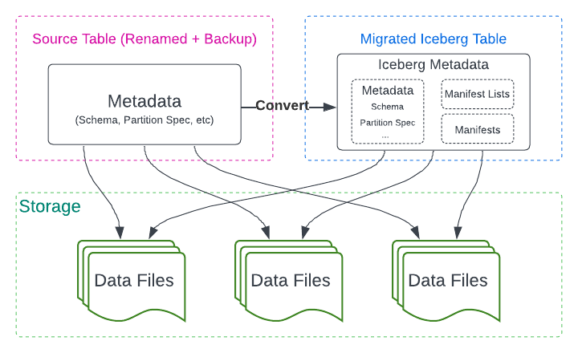
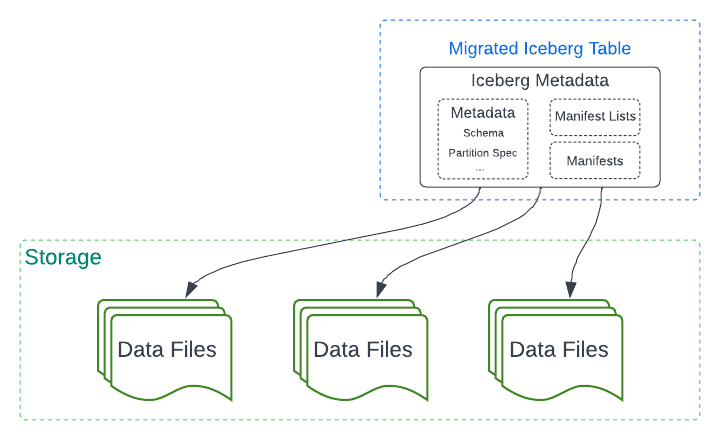

<!-- Apache Iceberg documentation, Apache License 2.0. Russian translation modified from the original. -->

# Миграция таблиц

Apache Iceberg позволяет преобразовывать существующие tables других formats в Iceberg. Здесь описаны общие подходы и операции migration.

## Подходы к миграции

Существует два основных подхода:

1. **Full data migration** — копирование всех data files source table в новую Iceberg table. Новая table полностью изолирована от source, но операция медленнее и временно требует примерно двойного storage. Практические способы: [[spark-ddl#CREATE TABLE AS SELECT|CTAS]], [[spark-writes#insert into|insert]], CDC pipelines.
2. **In-place metadata migration** — существующие data files не копируются; поверх них создаются Iceberg metadata. Это быстро и не дублирует data, но source и Iceberg table не полностью изолированы. Если source system физически vacuum/remove shared data file, Iceberg table также потеряет его.

Iceberg поддерживает три ключевых действия in-place migration:

- **Snapshot Table**;
- **Migrate Table**;
- **Add Files**.

## Snapshot Table

Создаёт новую Iceberg table с **другим именем**, такой же schema/partitioning и теми же data files, не изменяя source table.

1. Создаётся Iceberg table с той же metadata structure и новым identifier. Readers/writers source продолжают работать.

2. Все existing data files всех partitions commit в новую Iceberg table. Source остаётся без изменений. Readers можно переключить на Iceberg.

3. Затем переключаются writers. Когда все writers переведены, migration завершена.

## Migrate Table

Также создаёт Iceberg table с той же schema и partitioning, но во время операции **lock/drop source table в catalog**. Поэтому до запуска необходимо остановить writers source table. Readers, поддерживающие Iceberg, могут продолжить чтение.

1. Source writers остановлены.
2. Создаётся Iceberg table с **тем же identifier**. Source table переименовывается в backup для rollback.

3. Все data files commit в Iceberg metadata, source table удаляется из прежнего представления, writers могут писать в Iceberg.

## Add Files

После Snapshot/Migrate могут появиться files, созданные concurrent writers source system. Для Hive это новые data files, для Delta Lake — новые snapshots/versions. `Add Files` добавляет такие files в Iceberg metadata без полного повторного migration.

## Форматы

- [[hive-migration|Hive → Iceberg]]
- [[delta-lake-migration|Delta Lake → Iceberg]]
