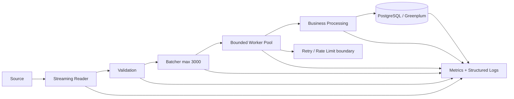

# Final Project — production-oriented `pricing-pipeline`

## Цель

Собрать service уровня, близкого к Data Engineering/backend production: streaming ingestion, validation, batching, bounded parallel processing, PostgreSQL/Greenplum sink, observability и measured performance.

Это не копия Airflow/NiFi. Задача — применить Go там, где нужен long-running/CLI service с явным resource ownership и concurrency model.

## Целевая архитектура



## Source abstraction

Первая version: file/HTTP source.

Kafka добавляется **после** стабильной source abstraction и core pipeline. Kafka integration не должна быть способом избежать понимания channels/context/backpressure.

Optional late architecture:

```text
Kafka consumer
     ↓
source adapter
     ↓
same validation/batching/worker pipeline
```

## Обязательные components

### Config

- environment/file/flags по выбранной простой strategy;
- startup validation;
- no secrets in logs.

### Structured logging

`log/slog`; operation/batch/store identifiers, durations, result/error classification.

### Context/lifecycle

- root context;
- request/job-derived contexts;
- cancellation to source/workers/DB/API;
- graceful shutdown deadline.

### Streaming reader

Не держит весь dataset в memory без evidence-driven причины.

### Validation

Domain validation отделена от transport parsing.

### Batcher

Configurable batch size; default exercise target 3000.

### Worker pool

Bounded workers + bounded queue; no goroutine per record.

### Business processing

Чистые/testable transforms, минимально завязанные на I/O.

### PostgreSQL/Greenplum

- `database/sql` lifecycle;
- connection budget;
- transactions where semantically needed;
- bulk/staging strategy documented;
- idempotency/restart policy.

### Retry

- only transient/idempotent operations;
- exponential backoff;
- bounded attempts/time;
- cancellation-aware.

### Rate limiting

External API calls имеют explicit rate/concurrency policy.

### Metrics/logging

Минимум:

- records read/valid/invalid;
- batches created/succeeded/failed;
- in-flight workers/queue depth;
- processing latency;
- DB pool wait/open/in-use;
- retry counts;
- error classes;
- goroutine/runtime indicators where justified.

### Tests

- unit;
- table-driven;
- fuzz parsing/validation;
- race;
- integration DB;
- cancellation/shutdown;
- error/retry scenarios.

### Benchmarks/profiling

- representative benchmark;
- CPU profile;
- heap/allocation profile;
- runtime trace for concurrent workload;
- one evidence-based optimization cycle;
- PGO experiment optional after representative workload.

### Docker

Reproducible build/runtime image. Multi-stage build допустим; image не должен содержать source/build tools без необходимости.

### README

Обязательно:

- architecture diagram;
- package structure;
- local startup;
- config table;
- DB setup;
- test commands;
- operational budgets;
- failure/retry/idempotency semantics;
- shutdown flow;
- profiling commands;
- known limitations.

## Suggested package shape

Это не обязательный universal template. Использовать только если boundaries соответствуют implementation:

```text
cmd/pricing-pipeline/
internal/
  config/
  model/
  source/
  validate/
  batch/
  process/
  storage/
  transport/
  observability/
```

Не создавать package только потому, что он есть в схеме.

## Failure scenarios для финальной защиты

Service должен пройти drills:

1. malformed source records;
2. slow source;
3. slow DB;
4. DB pool saturation;
5. transient external API errors;
6. permanent API error;
7. context timeout mid-batch;
8. process shutdown under load;
9. worker race regression test;
10. oversized input/batch attack-like scenario;
11. dependency vulnerability scan;
12. allocation/contention performance regression.

## Final acceptance criteria

Проект считается законченным, если инженер может:

- запустить его по README на clean environment;
- понять concurrency/resource model без чтения всего source;
- воспроизвести tests and profiles;
- безопасно отменить workload;
- объяснить connection/goroutine/queue budgets;
- показать отсутствие известных races на exercised paths;
- показать, как errors propagate и классифицируются;
- объяснить, почему выбранная архитектура подходит именно для pricing/data pipeline workload;
- найти нужный normative/reference материал в `../../docs/`, не превращая project README в новый учебник Go.

## Связанные stages

- [[../stages/10-production-go|Production Go]]
- [[../stages/11-security-and-hardening|Security]]
- [[../stages/12-performance|Performance]]
- [[../stages/13-language-specification|Specification]]
- [[../stages/14-runtime-internals|Runtime internals]]
